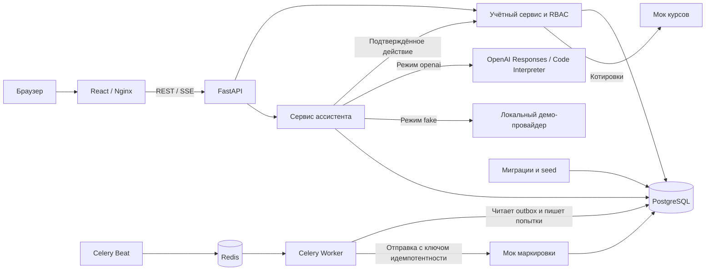

# CandleFlow

Мини-система склада и производства ароматических свечей. FastAPI, асинхронный SQLAlchemy 2 с asyncpg, PostgreSQL, Alembic, Celery + Redis и React + TypeScript + Tailwind.

## Архитектура

React работает через Nginx в Compose и через Vite при локальной разработке. FastAPI предоставляет REST и SSE. Складские операции и подтверждённые действия ассистента используют общий транзакционный сервис. PostgreSQL хранит учёт, аудит, предложения, диалоги и очередь доставки.



После завершения задания сервис сохраняет отчёт в outbox в той же транзакции. Celery Beat ставит задачу опроса через Redis. Worker читает отчёты из PostgreSQL и отправляет их в сервис маркировки. При сбое worker может повторить запрос с тем же ключом.

## Запуск

```sh
docker compose up --build
```

Откройте [интерфейс](http://127.0.0.1:8080) или [OpenAPI](http://127.0.0.1:8000/docs). Инициализация применяет миграции и загружает 11 материалов, 3 рецепта, 15 партий в RUB, USD и EUR и 5 заданий, включая задание с дефицитом. Данные PostgreSQL сохраняются в томе Compose. По умолчанию используется PostgreSQL 17 для совместимости с ранее созданными томами. Для новой установки на PostgreSQL 16 задайте `POSTGRES_IMAGE=postgres:16-alpine` перед первым запуском. Настройки для локального запуска перечислены в [.env.example](.env.example).

| Логин | Роль | Полномочия |
| --- | --- | --- |
| `warehouse` | Кладовщик (`storekeeper`) | Чтение, справочник материалов, поступление, проверка партий |
| `technologist` | Технолог | Чтение, создание рецептов, планирование, запуск, отмена, завершение |
| `manager` | Руководитель | Все операции |

Демо-пароль для трёх ролей — `demo-candleflow`. Все роли могут читать общие учётные данные в чате и управлять своей памятью. Планирование через чат доступно технологу и руководителю после подтверждения. Общий аудит доступен руководителю. Диалоги, файлы и память ограничены владельцем. Сессии используют непрозрачный токен в HttpOnly cookie. В PostgreSQL хранится его хеш.

## Переменные окружения

[.env.example](.env.example) содержит демонстрационные значения и пустое поле для ключа. Для запуска в Compose без OpenAI достаточно настроек по умолчанию.

| Переменная | Назначение |
| --- | --- |
| `POSTGRES_IMAGE` | Образ PostgreSQL в Compose. По умолчанию `postgres:17-alpine`. |
| `DATABASE_URL` | DSN PostgreSQL для API, миграций и worker. |
| `REDIS_URL` | Адрес брокера Celery. |
| `RATES_URL`, `MARKING_URL` | Адреса моков курсов и маркировки. |
| `AI_PROVIDER` | `fake` для демо или `openai` для реального Responses API. |
| `OPENAI_API_KEY` | Ключ для живого ассистента и ручной оценки. Передавайте через окружение или локальную `.env`. |
| `PRIMARY_MODEL`, `FALLBACK_MODEL` | Основная и запасная модели GPT. |
| `LLM_TIMEOUT` | Лимит одного обращения к LLM в секундах. По умолчанию 45. |
| `TEST_DATABASE_URL`, `EVAL_DATABASE_URL` | Отдельные DSN для pytest и ручного eval. Задаются в окружении команд запуска. |
| `CANDLEFLOW_API_PROXY` | Адрес API для локального Vite. По умолчанию `http://localhost:8000`. |

Compose задаёт внутренние адреса `DATABASE_URL`, `REDIS_URL`, `RATES_URL` и `MARKING_URL` в [compose.yaml](compose.yaml). Значения с `localhost` в примере предназначены для процессов, запущенных на хосте.

## Демо-данные

Seed выполняется одной транзакцией и отмечает версию после успешной записи. Повторный запуск, в том числе в другую дату, сохраняет числа и даты записей. Для чистой базы относительные даты привязаны к московской дате первого запуска. Прежняя демобаза получит новые партии и пример планирования однократно. Существующие резервы и учётные записи сохраняются. Если в базе уже есть учётные записи или справочники и она не распознаётся как прежняя демобаза, seed пропускает заполнение.

| Что показать | Где посмотреть на чистой базе |
| --- | --- |
| Валюта и выходной курс | Партия #15 поступила в субботу в USD. В карточке указана дата курса предыдущей пятницы. |
| Статусы партии | Партии #12 и #13 приняты, более ранняя #14 забракована, #15 ожидает проверки. |
| FIFO | Задание #4 резервирует 18 кг соевого воска из партий #12, #13 и #1 в порядке дат. Движения показывают 2,6 кг, 12 кг и 3,4 кг соответственно. |
| Частичный резерв | У задания #4 зарезервировано 0,70 кг лавандовой отдушки из 1 кг. Карточка показывает дефицит 0,30 кг. У задания #5 есть полный резерв. |
| История и расход | Аудит партии #12 показывает приёмку и изменения резерва. Завершённые задания #1–#3 дают точки расхода воска за три разные недели за последние 90 дней. |

## Интерфейс

Выберите демонстрационную учётную запись на экране входа или смените роль в боковой панели. Переключатель проходит штатный вход, а прежняя сессия закрывается. Войти под своим логином можно через пункт «Ввести логин».

В реестре партии фильтруются по столбцам. Заголовок столбца переключает направление серверной сортировки, номер открывает карточку. На узком экране таблица прокручивается внутри панели, номер партии остаётся видимым. У материалов в карточке задания цвет продублирован текстом о резерве.

В «Журнале аудита» руководитель может искать изменения по сотруднику, объекту и периоду, раскрывать значения до и после и переходить к партиям и заданиям. Общий журнал доступен только руководителю. В чате отдельно видны модель, выполненные вызовы и их статусы. Файлы скачиваются из сообщения, а факты доступны в разделе «Память».

## Ассистент

По умолчанию работает `AI_PROVIDER=fake`. Демо-провайдер поддерживает эталонные формулировки, выполняет те же инструменты и помечает имитацию Code Interpreter. Для живого режима скопируйте `.env.example` в `.env`, укажите `AI_PROVIDER=openai` и переданный организаторами `OPENAI_API_KEY`. Затем пересоздайте API командой `docker compose up -d api`. Ключ передаётся через окружение. Приложению достаточно доступа к Responses API и файлам/контейнерам.

Основная модель `gpt-5-mini` выбрана для компактного рассуждения и вызова функций, запасная `gpt-6-luna` для быстрого ответа при сбое. Обе настраиваются через окружение. Провайдер переключается при 429, 5xx, ошибке соединения и таймауте. Если модель уже начала выдачу, чат показывает начало новой попытки и заменяет незавершённый фрагмент. В сообщении сохраняются модели попыток и статусы инструментов. Для GPT используется тонкий адаптер Responses API. [Документация Code Interpreter](https://developers.openai.com/api/docs/guides/tools-code-interpreter).

Примеры вопросов:

- «Какой общий и свободный остаток соевого воска?»
- «Чего не хватает на задания этой недели?»
- «Запланируй 20 свечей Лаванда на пятницу».
- «Построй график расхода соевого воска по неделям за квартал».
- «Запомни, считать в евро». Подтвердите предложение. При запросе себестоимости доступен пересчёт по демонстрационному курсу на текущую дату.

Сообщения сохраняются в PostgreSQL. Чат читает SSE через Fetch, кнопка «Остановить» отменяет генерацию в процессе API через серверный запрос. Полученный текст сохраняется с меткой `interrupted`. Для предложения сервер хранит владельца через диалог, параметры и срок 30 минут в `pending_actions`. Запись предпочтения использует тот же порядок подтверждения. При подтверждении сервис под блокировкой проверяет актуальную роль и создаёт задание с резервом. Повторное подтверждение возвращает существующее задание.

Модель получает разрешённые результаты функций и ограниченную выборку справочников. Сервер проверяет числовые литералы перед показом по результатам вызванных инструментов и журналу Code Interpreter. Комментарии к партиям исключаются из данных для модели. Перед отправкой известные ФИО и поставщики заменяются устойчивыми псевдонимами. Поддерживаются распространённые варианты юрформ, пунктуации, падежей и инициалов. При неоднозначном совпадении имя обезличивается без раскрытия. Произвольные имена вне справочников покрываются частично. Для загрузок CSV/XLSX сохраняются числа, даты, валюты и разрешённые заголовки, прочие текстовые ячейки заменяются псевдонимами категорий. Для Excel используется первый активный лист и сохранённые значения формул. Лимит входного файла 2 МБ. Файлы расчётов PNG, CSV и XLSX привязываются к сообщению и доступны владельцу диалога. Из API провайдера временные исходные файлы удаляются после попытки генерации.

## Учёт и доставка

- FIFO по дате поступления и номеру партии. Резерв и списание защищены блокировками PostgreSQL в общем порядке по коду материала, дате и номеру. В расчётах используются Decimal, в базе NUMERIC.
- Отдельный HTTP-мок публикует детерминированные котировки по будням. Для субботы и воскресенья используется предыдущая пятница. В партии и аудите хранятся значение и фактическая дата курса. Себестоимость запланированного задания считается по резерву, в работе по выданным партиям, завершённого по фактическому расходу.
- Черновик не резервирует сырьё. При планировании дефицит отражается в компонентах и блокирует запуск. Черновики и запланированные задания можно отменить. При дефиците после поступления можно отменить задание и запланировать заново.
- Запуск списывает резерв со склада и фиксирует выданное количество по исходным партиям. Завершение возвращает экономию в эти партии и покрывает перерасход из свободного остатка по FIFO. Если свободного остатка мало, транзакция откатывается с указанием недостающего количества. Дата учёта определяется по Москве.
- Физический остаток учитывает все партии. Свободный остаток рассчитывается по принятым партиям за вычетом резерва. Кладовщик и технолог видят данные общей мастерской, руководитель имеет права обеих ролей.
- Запись отчёта и ключа идемпотентности атомарна с завершением. Celery опрашивает outbox через Redis, блокирует записи через `SKIP LOCKED` и повторяет отправку с растущей паузой до 15 минут. Мок хранит уникальный ключ получателя и иногда отвечает HTTP 500 либо с задержкой 10 секунд. Повтор после потери ответа возвращает тот же результат.

## Схема данных и REST API

| Область | Таблицы и связи |
| --- | --- |
| Склад | `suppliers` → `receipts` → `batches`. Каждая партия ссылается на `materials` и конкретную котировку из `exchange_rates`. |
| Производство | `recipes` → `recipe_items`. `production_jobs` содержит `job_requirements`. `reservations` связывает задание с исходной партией по составному ключу `(job_id, batch_id)`. |
| История и доставка | `stock_movements` хранит изменения физического остатка и резерва. `audit_logs` хранит инициатора и снимки до и после. Отчёт и ключ идемпотентности находятся в `outbox_events`, результаты отправок в `marking_attempts`. |
| Ассистент | `users` → `conversations` → `messages`. С сообщением связаны `tool_executions`, `pending_actions` и `assistant_files`. `assistant_memories` привязана к пользователю. `pseudonym_mappings` содержит один псевдоним на канонического сотрудника или поставщика. |

`batches.quantity` и `batches.reserved` — текущий физический остаток и активный резерв. PostgreSQL проверяет `0 ≤ reserved ≤ quantity ≤ received`. Резерв допустим только у принятой партии. Свободный остаток — `quantity − reserved` по принятым партиям. Резерв проходит состояния `active`, `issued`, `released` или `settled`. Журнал пишет две дельты в той же транзакции, что и изменение остатков. Сумма дельт партии даёт её текущий баланс.

Предварительное списание идёт из партий, указанных в резерве. При завершении фактический расход сначала покрывается ранее выданным сырьём. Экономия возвращается в соответствующие партии. Перерасход списывается по FIFO только на свободном остатке. При дефиците откатываются изменения остатков, резервов, движений, аудита и отчёта. Индекс FIFO покрывает принятые партии по материалу, дате и ID. Дата поступления хранится в партии для этого индекса и согласована с заголовком составным внешним ключом. Индексы также обслуживают фильтры по статусу, дате и поступлению, выборки истории и очередь отчётов.

Деньги, цены и количества хранятся в PostgreSQL `NUMERIC` и обрабатываются как Python `Decimal`. Входные нормы, количества, цены и курсы принимают до шести знаков после запятой. Количество изделий целочисленное. Норма умножается на тираж, цена на курс, а затраты суммируются в полной точности без промежуточного округления. Котировки неизменяемы в прикладных операциях. Если источник публикует другую величину на ту же дату, новая партия ссылается на отдельную запись. Дополнительный пересчёт суммы в валюту предпочтения округляется до двух знаков методом `ROUND_HALF_EVEN`. API передаёт десятичные числа строками.

У старых партий не было идентификатора документа, поэтому миграция создаёт для каждой такой партии отдельное историческое поступление. Для старого баланса записывается движение `opening`. Предшествующие изменения остаются в аудите. Номера партий и заданий сохраняются.

Контракты, cookie-аутентификация и ошибки описаны в [Swagger UI](http://127.0.0.1:8000/docs). Машиночитаемая схема доступна по `/openapi.json`. Создание черновика идёт через `POST /api/jobs/drafts`. Операции `plan`, `start`, `complete` и `cancel` находятся под `/api/jobs/{job_id}`. `POST /api/jobs` по-прежнему создаёт и планирует задание одной транзакцией. Отдельные маршруты истории партий и заданий возвращают аудит и движения с пагинацией. Создание поступления возвращает его партии с общим `receipt_id`, по которому доступен заголовок. Диалоги, SSE, остановка, подтверждение, память и скачивание файлов используют ту же cookie-сессию и проверку владельца.

## Проверки

```sh
docker compose exec db createdb -U candleflow candleflow_test
docker compose run --rm -e TEST_DATABASE_URL=postgresql+psycopg://candleflow:candleflow@db:5432/candleflow_test api python -m pytest -q
docker compose run --rm api ruff check .
npm --prefix frontend ci
npm --prefix frontend run lint
npm --prefix frontend run build
```

Pytest использует отдельную PostgreSQL-базу. При запуске на хосте установите зависимости командой `python -m pip install -e ".[dev]"` и задайте `TEST_DATABASE_URL`. Имя базы должно оканчиваться на `_test`. Интеграционный прогон применяет миграции и очищает таблицы между сценариями. Без тестовой PostgreSQL-базы эти сценарии завершаются ошибкой конфигурации.

Набор принудительно включает fake-провайдер и очищает ключ OpenAI в тестовом процессе. API и мок курсов вызываются через ASGI, ответы маркировки и ошибки OpenAI воспроизводятся HTTP-транспортом в памяти. Фикстура блокирует внешние DNS и TCP подключения Python, оставляя разрешённую тестовую БД и локальные сокеты.

Покрыты FIFO, частичный резерв, конкурентное планирование и однократное списание, запрет запуска с дефицитом, экономия и перерасход, отмена, RBAC в REST и ассистенте, fallback на 429, 5xx и таймаутах, отсутствие повторного запроса при 400 и 422, псевдонимы, изоляция памяти, идемпотентная маркировка и подтверждение, сохранение прерванного SSE и восстановление после ошибки Code Interpreter.

## Ручная оценка ассистента

Runner содержит 13 сценариев. В [наборе](evals/cases.json) зафиксированы дата учёта и ожидаемые числа. Каждый запуск создаёт отдельную схему внутри PostgreSQL-базы с суффиксом `_eval`, применяет миграции, заполняет данные и удаляет только временную схему по завершении. Сценарий с подтверждением идёт последним, чтобы исходные остатки предыдущих сценариев совпадали.

На хосте задайте `EVAL_DATABASE_URL` для отдельной PostgreSQL-базы и запустите:

```sh
python scripts/run_ai_evals.py --mode fake
```

В Compose выделите отдельную базу один раз. Следующая команда с подключённым каталогом записывает отчёт обратно в рабочую папку:

```sh
docker compose exec db createdb -U candleflow candleflow_eval
docker compose run --rm -e EVAL_DATABASE_URL=postgresql+psycopg://candleflow:candleflow@db:5432/candleflow_eval -v "${PWD}/evals:/app/evals" api python -m scripts.run_ai_evals --mode fake
```

Для живой проверки укажите `OPENAI_API_KEY` через окружение или `.env` и выберите `--mode live`. Судья отдельно оценивает ясность и полноту по шкале от 0 до 2. Его модель можно задать через `--judge-model`. Без ключа живой прогон и судья помечаются как невыполненные. В режиме fake проверяются маршрутизация инструментов и изменения БД. График, пересчёт цены и анализ CSV в этом режиме учитываются как частично проверенные.

Машинные проверки сверяют точные значения с эталоном, а состояние БД до подтверждения, после него и после повтора с ожидаемыми изменениями. Отчёт сохранён в [evals/latest_report.md](evals/latest_report.md). Автоматические тесты и CI не запускают живой eval. [Прежний отчёт деморежима](QUALITY_REPORT.md) сохранён для истории. [Ревью](REVIEW.md) и [план](IMPLEMENTATION_PLAN.md) доступны в репозитории.

## Материалы сдачи

- [Инструкция для записи видео до 5 минут](VIDEO_GUIDE.md) с заданием на 200 свечей «Лаванда». [Предыдущий демонстрационный ролик](DEMO.webm) показывает тот же сценарий на 20 свечах.
- [Ревью резервирования](REVIEW.md), [план и результаты проверок](IMPLEMENTATION_PLAN.md), [последний отчёт eval](evals/latest_report.md) и [.env.example](.env.example).

## Что готово и что осталось проверить

Реализованы учёт партий и производство с FIFO, права трёх ролей, аудит, интерфейс, доставка отчётов через outbox, SSE-чат с подтверждением, память, псевдонимы, демо-режим и ручная оценка ассистента. Правила движения запасов, округления и доступа описаны выше. Поиск по PDF, поиск поставщиков, голос, экспорт реестра, автоматический браузерный набор и CI оставлены за рамками обязательной части. Псевдонимизация покрывает известные справочнику имена и типовые варианты написания.

### Проверка перед сдачей

| Проверка | Результат |
| --- | --- |
| `docker compose up --build` | Выполнена попытка запуска. Команда `docker` в среде отсутствует. Стек Compose, прокси Nginx и связка Celery с Redis остаются непроверенными в контейнерах. YAML прочитан, в конфигурации восемь сервисов. |
| `python -m pytest -q` | 47 тестов прошли на локальном PostgreSQL 18. |
| `alembic check` | Модели соответствуют миграциям. |
| `ruff check .`, `ruff format --check .` | Прошли. |
| `npm --prefix frontend run lint`, `npm --prefix frontend run build` | ESLint, TypeScript и сборка Vite прошли. |
| `/docs`, `/openapi.json` | HTTP 200 напрямую через локальный FastAPI и через прокси Vite. |
| Сценарий видео | Пройден в Chrome на свежей демобазе в режиме fake. Подтверждение создало задание на 200 свечей «Лаванда». Проверены дефицит 2 кг отдушки и 50 коробок и недоступность запуска. |
| Ручной eval | Fake проверил 10 сценариев полностью и 3 частично. Ключ OpenAI в среде отсутствует. Живой ассистент, нативный Code Interpreter и LLM-судья не проверены. |

### Локальная проверка Swagger без Docker

С работающей PostgreSQL-базой задайте `DATABASE_URL` в окружении. Для демоданных используйте отдельную пустую базу.

```sh
python -m pip install -e ".[dev]"
alembic upgrade head
python -m candleflow.seed
python -m uvicorn candleflow.main:app --host 127.0.0.1 --port 8000
```

В другом терминале откройте `http://127.0.0.1:8000/docs` и проверьте `/openapi.json`. Для UI запустите `npm --prefix frontend run dev`. Мок курсов и обработка очереди запускаются отдельными процессами при проверке полного стека.

### Ручная проверка Compose и OpenAI

На машине с Docker выполните в корне проекта:

```sh
docker compose config --quiet
docker compose up --build
```

В другом терминале проверьте сервисы, Swagger напрямую и через Nginx:

```sh
docker compose ps --all
curl --fail http://127.0.0.1:8000/health
curl --fail http://127.0.0.1:8000/docs
curl --fail http://127.0.0.1:8080/docs
```

После завершения задания в интерфейсе проверьте доставку отчёта:

```sh
docker compose logs --tail=100 worker marking
docker compose exec db psql -U candleflow -d candleflow -c 'SELECT job_id, delivered FROM outbox_events ORDER BY job_id;'
docker compose exec db psql -U candleflow -d candleflow -c 'SELECT job_id, number, outcome FROM marking_attempts ORDER BY id;'
```

Для ручной проверки OpenAI задайте `OPENAI_API_KEY` в локальной `.env`, установите `AI_PROVIDER=openai` и выполните `docker compose up -d api`. Проверьте вопрос об остатках и аналитический запрос с графиком. Для прогона всех эталонов используйте команду из раздела ручной оценки с `--mode live`. Ключ остаётся в окружении.
